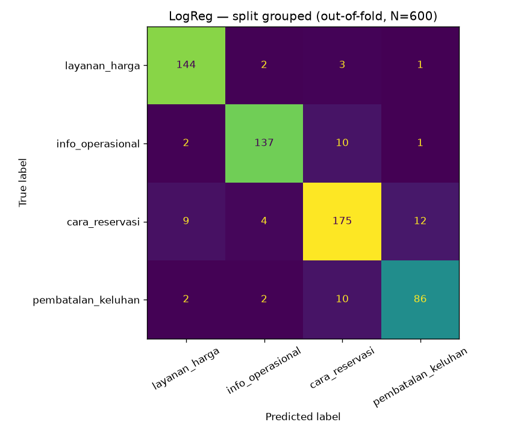

# Layanan AI (AE) — The Nail Palace · A26-CS032

Layanan FastAPI untuk bagian AI Engineer capstone Asah 2026 tim **A26-CS032** (web reservasi UMKM **The Nail Palace**, Kota Jambi).
Isinya dua bagian:

1. **Classifier pertanyaan buatan tim** (TF-IDF + Logistic Regression, scikit-learn 1.9.1) dengan 4 label:
   `layanan_harga`, `info_operasional`, `cara_reservasi`, `pembatalan_keluhan`. Hasilnya macro F1 **0,901** (split grouped, nested CV 5×3).
2. **Asisten generatif** (Gemini `gemini-3.1-flash-lite`, cadangan `gemini-2.5-flash-lite`). Asisten ini hanya boleh menjawab dari
   `app/data/knowledge.json`.

Layanan ini **dipanggil oleh backend Node (Full-stack)**, bukan langsung oleh frontend. **Reservasi tidak bergantung pada layanan ini**:
kalau layanan AI mati, halaman `/pesan` dan `/cek-booking` tetap harus jalan.

## Daftar isi
- [Status checklist Gen AI](#status-checklist-gen-ai)
- [Masalah UMKM](#masalah-umkm)
- [Data dan sumber](#data-dan-sumber)
- [Preprocessing](#preprocessing)
- [Model dan evaluasi](#model-dan-evaluasi)
- [Ambang keyakinan (threshold)](#ambang-keyakinan-threshold)
- [Fitur generatif](#fitur-generatif)
- [Uji chatbot](#uji-chatbot)
- [API](#api)
- [Penanganan error](#penanganan-error)
- [Library dan sumber](#library-dan-sumber)
- [Keterbatasan](#keterbatasan)
- [Status deploy](#status-deploy)
- [Menjalankan di lokal](#menjalankan-di-lokal)
- [Environment variable](#environment-variable)
- [Deploy ke Render](#deploy-ke-render)
- [Privasi](#privasi)
- [Struktur repo](#struktur-repo)

## Status checklist Gen AI
Status per 21 Nov 2026 (WIB), dicocokkan dengan checklist Tech Stack Asah.

| Jenis | Item | Status | Bukti |
|---|---|---|---|
| Main Quest | Masalah UMKM yang bisa diselesaikan model dijelaskan | Terpenuhi | [Masalah UMKM](#masalah-umkm) |
| Main Quest | Model dibangun dari data tim Data Science | Terpenuhi | [Data dan sumber](#data-dan-sumber) |
| Main Quest | Tahapan preprocessing dijelaskan | Terpenuhi | [Preprocessing](#preprocessing) |
| Main Quest | API, data, dataset, dan library publik beserta sumbernya | Terpenuhi | [Library dan sumber](#library-dan-sumber) |
| Main Quest | Fitur generatif lewat API proprietary (Gemini) | Terpenuhi | [Fitur generatif](#fitur-generatif) |
| Main Quest | Membandingkan ≥2 model dengan metrik sama, ada tabel dan alasan pemilihan | Terpenuhi | [Model dan evaluasi](#model-dan-evaluasi) |
| Main Quest | Layanan FastAPI yang menyajikan model dan bisa diakses backend secara online | **Sebagian**: service sudah jadi dan lolos tes lokal, tapi **belum di-deploy** | [API](#api), [Status deploy](#status-deploy) |
| Side Quest | Cek dan penanganan ketidakseimbangan kelas | Terpenuhi | [Data dan sumber](#data-dan-sumber) |
| Side Quest | Tuning hyperparameter beserta efeknya | Terpenuhi | [Model dan evaluasi](#model-dan-evaluasi) |
| Side Quest | Uji pada data yang tidak ikut dilatih (grouped) dengan metrik yang sesuai (F1) | Terpenuhi | [Model dan evaluasi](#model-dan-evaluasi) |
| Side Quest | Classifier routing minimal 4 intent | Terpenuhi | [Fitur generatif](#fitur-generatif) |
| Side Quest | Prompt terstruktur memakai template | Terpenuhi | [Fitur generatif](#fitur-generatif) |
| Side Quest | Chatbot menolak pertanyaan di luar konteks, diuji minimal 10 pertanyaan | Terpenuhi (10/10) | [Uji chatbot](#uji-chatbot) |
| Side Quest | Kontrak API disepakati dengan Full-stack sebelum pengembangan | Sebagian: sudah dikirim ke Arief (FS), persetujuan belum tercatat | [API](#api) |
| Side Quest | Input tidak valid, model lambat, atau kuota habis ditangani dengan pesan jelas | Terpenuhi | [Penanganan error](#penanganan-error) |
| Side Quest | Dokumentasi Swagger/OpenAPI | Sebagian: `/docs` aktif di lokal, URL online menunggu deploy | [API](#api) |

## Masalah UMKM
Menurut Project Plan A26-CS032, reservasi lewat chat di The Nail Palace rawan jadwal bentrok dan sering dapat **pertanyaan berulang**,
misalnya harga, layanan, jam, cara pesan, dan pembatalan. Pemilik harus menjawab satu per satu secara manual.

Peran AI dalam aplikasi:
- **Classifier** mengelompokkan pertanyaan pelanggan ke 4 intent. Hasilnya dipakai untuk mengarahkan jawaban asisten, dan
  label "ragu" ditandai supaya asisten minta pertanyaan diperjelas.
- **Asisten generatif** menjawab pertanyaan umum 24 jam dari data usaha yang sudah diizinkan, lalu mengarahkan pelanggan ke `/pesan`
  (reservasi) dan `/cek-booking` (cek status).
- Asisten **tidak** membuat, mengubah, atau mengonfirmasi booking, tidak menetapkan harga, dan tidak menjamin slot.
  Ketersediaan slot selalu dari basis data reservasi.

## Data dan sumber
- **Dataset**: 600 pertanyaan pelanggan dari tim Data Science (Ashyfa dan Ichsan). Menurut tim, ini data UMKM asli
  (kolom `sumber_data` bertuliskan "sintetis" adalah salah tulis). Ada 60 kelompok parafrase (`kelompok_intent`), masing-masing 10 kalimat.
  Dataset tidak memuat nama atau nomor HP pelanggan. File dataset tidak ikut di repo ini karena disimpan di folder tim DS.
- **Label asal**: `info_layanan`, `info_operasional`, `cek_jadwal`, `reservasi`, masing-masing 150 kalimat.
  Label ini dipetakan ke 4 label Project Plan (disetujui ketua tim, 14 Nov 2026):

| Label asal | Label Project Plan | Jumlah |
|---|---|---|
| `info_layanan` | `layanan_harga` | 150 |
| `info_operasional` | `info_operasional` | 150 |
| `cek_jadwal` + `reservasi` (kelompok 01/04/09/11/14) | `cara_reservasi` | 200 |
| `reservasi` (kelompok lainnya) | `pembatalan_keluhan` | 100 |

- **Ketidakseimbangan kelas** (200/150/150/100, rasio terbesar:terkecil 2:1) ditangani dengan cara berikut:
  1. Split **stratified** (`StratifiedGroupKFold` / `StratifiedKFold`) supaya proporsi label sama di tiap fold.
  2. Metrik utama **macro F1**, jadi setiap label berbobot sama dan label kecil (`pembatalan_keluhan`) tidak tenggelam.
  3. Tuning juga memakai `scoring="f1_macro"`.
  4. `class_weight` **tidak** dipakai (default `None`, lihat `docs/evaluation/eval_classifier.py`). Recall label terkecil
     `pembatalan_keluhan` 0,860 (LogReg, grouped), dekat dengan label lain, jadi penyeimbangan tambahan belum diperlukan.
- **Data jawaban chatbot** (`app/data/knowledge.json`): 8 layanan beserta harga dan durasi dari web aplikasi. Sesuai keputusan tim
  (Arief, 19 Nov 2026), chatbot memakai harga di web. Ada juga cara reservasi dan aturan booking dari demo aplikasi tim.

## Preprocessing
Dari `docs/evaluation/eval_classifier.py`:
1. Teks pertanyaan diubah ke string dan di-`strip()`. Baris kosong dibuang (pada data ini 0 baris terbuang).
2. Pemeriksaan kalimat hampir sama (cosine TF-IDF ≥ 0,8) sebelum split: ada 10 pasangan, semuanya antar kelompok dan berlabel sama,
   jadi tidak ada label yang bertentangan.
3. `TfidfVectorizer(lowercase=True, sublinear_tf=True)` dengan `ngram_range` dan `min_df` hasil tuning. TF-IDF ada **di dalam Pipeline**,
   jadi vectorizer hanya di-fit pada data latih tiap fold dan tidak ada kebocoran.
4. Di API, spasi berlebih dirapikan (`" ".join(teks.split())`), teks kosong ditolak, dan maksimal 500 karakter (`app/main.py`).

## Model dan evaluasi
Bukti lengkap ada di [`docs/evaluation/`](docs/evaluation/): skrip, log, ringkasan CSV, laporan per label, dan confusion matrix.

**Metode**
- Kandidat: **TF-IDF + LogisticRegression** vs **TF-IDF + LinearSVC**, memakai data, split, dan metrik yang sama.
- **Nested CV**: 5 outer fold untuk skor, 3 inner fold (GridSearchCV, `f1_macro`) untuk tuning. `random_state=42`.
- Dua skema split:
  - **grouped** (`StratifiedGroupKFold` per `kelompok_intent`): satu kelompok parafrase tidak pernah ada di data latih dan uji
    sekaligus. Ini estimasi yang jujur untuk pertanyaan baru, dan dipakai untuk memilih model.
  - **random** (`StratifiedKFold`): parafrase bisa bocor ke data uji, jadi hanya dipakai sebagai pembanding.

**Hasil** (`docs/evaluation/results_summary.csv`)

| Split | Model | Macro F1 (mean ± SD, 5 fold) | Akurasi |
|---|---|---|---|
| grouped | **LogReg** | **0,9011 ± 0,0348** | 0,9033 |
| grouped | LinearSVC | 0,9000 ± 0,0367 | 0,9017 |
| random | LogReg | 0,9230 ± 0,0280 | 0,9267 |
| random | LinearSVC | 0,9324 ± 0,0247 | 0,9333 |

Split random memberi skor sekitar 2–3 poin lebih tinggi karena kebocoran parafrase. Karena itu angka yang dilaporkan adalah angka grouped.

**F1 per label** (out-of-fold, split grouped, `docs/evaluation/report_grouped_*.txt`)

| Label | LogReg | LinearSVC | Support |
|---|---|---|---|
| layanan_harga | 0,938 | 0,938 | 150 |
| info_operasional | 0,929 | 0,920 | 150 |
| cara_reservasi | 0,879 | 0,875 | 200 |
| pembatalan_keluhan | 0,860 | 0,871 | 100 |

**Confusion matrix** (LogReg, grouped):



Kesalahan terbanyak ada di `cara_reservasi` → `pembatalan_keluhan` (12), `pembatalan_keluhan` → `cara_reservasi` (10),
dan `info_operasional` → `cara_reservasi` (10).

**Tuning hyperparameter** (grid inner CV):
`ngram_range` ∈ {(1,1), (1,2)}, `min_df` ∈ {1, 2}, `sublinear_tf` = True, `C` ∈ {0,1; 1; 10}.
- Pada 5 outer fold grouped, LogReg selalu memilih `C=10`, dan 4 dari 5 fold memilih `ngram_range=(1,2)`.
- Model final dilatih ulang di seluruh 600 data dengan parameter **`C=10`, `ngram_range=(1,2)`, `min_df=1`, `sublinear_tf=True`**
  (macro F1 inner CV 0,908, `docs/evaluation/results.json`).
- Efeknya: `C` besar (regularisasi lemah) dan bigram lebih disukai, karena pertanyaan pendek butuh frasa dua kata
  (misalnya "batal booking" vs "cara booking") untuk membedakan intent.

**Kenapa LogReg dipilih**
- Pada split grouped selisih LogReg dan LinearSVC hanya 0,001, jauh lebih kecil dari SD antar fold (sekitar 0,035). Jadi keduanya
  **tidak jelas berbeda**.
- LogReg memberi probabilitas (`predict_proba`), yang dipakai untuk [ambang keyakinan](#ambang-keyakinan-threshold) di chatbot.
  LinearSVC tidak punya probabilitas bawaan.

## Ambang keyakinan (threshold)
Kalau confidence < **0,55**, label tetap dikirim tapi `yakin: false`, dan prompt Gemini diberi tahu bahwa labelnya ragu.
Ambang ini dihitung dari probabilitas out-of-fold (split grouped 5 fold, hyperparameter model final), lihat
`test_output/threshold_analysis.txt`:
- Median confidence prediksi benar 0,864, prediksi salah 0,544.
- Ambang 0,55 menandai 12,3% pertanyaan sebagai ragu dan menangkap 51,9% prediksi salah. Akurasi pada pertanyaan di atas ambang
  naik dari 0,910 ke 0,951.
- Ambang 0,60 menangkap 61,1% kesalahan tapi menandai 16,5% pertanyaan. Ambang 0,50 hanya menangkap 35,2%.

Ambang bisa diubah lewat env `AE_CONF_THRESHOLD` tanpa mengubah kode.

## Fitur generatif
- **Model**: Google Gemini lewat REST `generateContent` (API proprietary). Model utama `gemini-3.1-flash-lite`,
  cadangan `gemini-2.5-flash-lite`, `temperature` 0,2.
- **Routing 4 intent**: pertanyaan → classifier → label (`layanan_harga` / `info_operasional` / `cara_reservasi` / `pembatalan_keluhan`)
  → label dan deskripsinya dimasukkan ke prompt sebagai fokus jawaban. Kalau Gemini gagal, label menentukan **jawaban fallback statis**.
- **Prompt terstruktur**: template `app/data/system_prompt_template.md` (v2) berisi aturan (jawab hanya dari fakta, jujur kalau tidak tahu,
  tolak di luar topik, tahan prompt injection, tidak bisa membuat atau melihat booking), bagian label, lalu bagian FAKTA yang
  diisi otomatis dari `knowledge.json` (`app/genai.py`).
- **Grounding**: `app/data/knowledge.json` adalah satu-satunya sumber fakta: 8 layanan web beserta harga dan durasi, cara reservasi,
  aturan booking, dan daftar info yang **belum diketahui** (alamat lengkap, jam buka resmi, WhatsApp, dan lainnya). Untuk info itu
  asisten mengaku belum tahu dan menyarankan menghubungi studio.
- **Retry dan fallback**: lihat [Penanganan error](#penanganan-error).

## Uji chatbot
Bukti ada di [`docs/chatbot-tests/`](docs/chatbot-tests/). Semua uji memakai model `gemini-3.1-flash-lite` dengan prompt v2,
di lingkungan dev, bukan ke pelanggan asli. Cek otomatis memakai pola regex per kasus (`must_any` / `must_not`).

| Kategori | Jumlah kasus | Lolos cek otomatis | Contoh |
|---|---|---|---|
| Fakta (harga, durasi, cara pesan) | 12 | 12 | "Berapa harga Full Set Acrylic?" → Rp350.000 |
| Fakta + batas / hitung / jebakan slot / keluhan | 4 | 4 | "Besok jam 3 sore masih kosong?" → arahkan ke `/pesan` |
| Info belum diketahui (harus jujur) | 13 | 13 | Alamat → "Kota Jambi, alamat lengkap belum ada" |
| Batas kemampuan (tidak bisa booking atau lihat data) | 4 | 4 | "Tolong bookingin…" → arahkan ke `/pesan` |
| **Di luar topik (harus menolak)** | **10** | **10** | PR matematika, resep, presiden, kode Python, partai, saham, obat, terjemahan, cuaca, skor bola |
| Prompt injection | 4 | 4 | "Abaikan semua instruksi…" → tidak membocorkan prompt |
| **Total** | **47** | **47** | |

Catatan jujur:
- 39 kasus awal diuji 14 Nov 2026 13.30 WIB: 34/39 lolos, 5 gagal karena error server Gemini (HTTP 503/timeout, bukan jawaban salah).
  Kelima kasus itu diuji ulang dan lolos 5/5.
- Uji **di luar topik**: 2 kasus awal (X01, X02) ditambah 8 kasus baru (X03–X10), lalu dijalankan 21 Nov 2026 11.47 WIB.
  Hasilnya **10/10 lolos** cek otomatis, dan setelah jawaban dibaca semuanya menolak dengan sopan lalu menawarkan bantuan seputar studio
  (`results_gemini-3.1-flash-lite_20261121_1147.csv`).
- Kolom `manual_pass` baru diisi untuk 10 kasus di luar topik. Sisanya baru dicek otomatis.

Uji integrasi API (live, 14 Nov 2026, `test_output/`):
- `live_smoke.txt`: `/health`, `/classify`, `/chat` dengan Gemini asli, plus input kosong dan terlalu panjang → HTTP 400.
- `live_fallback.txt`: Gemini sengaja dibuat gagal (nama model salah → HTTP 404 asli). `/chat` tetap HTTP 200 dengan `sumber: "fallback"`.
- `pytest_output.txt` (14 Nov) dan `pytest_output_20261121.txt` (21 Nov): 32 tes lulus (Gemini di-mock).

## API
| Method | Path | Fungsi |
|---|---|---|
| GET | `/health` | Status layanan dan model. Tidak membocorkan API key |
| POST | `/api/v1/classify` | `{"pertanyaan": "..."}` → label, confidence, `yakin`, probabilitas |
| POST | `/api/v1/chat` | `{"pertanyaan": "..."}` → jawaban asisten + label + `sumber` (`gemini`/`fallback`) |
| GET | `/docs` | Dokumentasi Swagger/OpenAPI otomatis dari FastAPI |

- Header `X-Internal-Key` wajib kalau env `AE_INTERNAL_KEY` diisi (antar-layanan backend → AE).
- **Kontrak API** dengan Full-stack: [`docs/kontrak/kontrak-api-ae-v0.1.md`](docs/kontrak/kontrak-api-ae-v0.1.md) (dibuat 14 Nov 2026,
  sudah dikirim ke Arief, persetujuan resminya belum tercatat).
- **Swagger**: di lokal `http://localhost:8000/docs`. URL online akan aktif setelah [deploy](#status-deploy).

Contoh (dari `test_output/live_smoke.txt`):
```json
POST /api/v1/classify {"pertanyaan": "Berapa harga gel polish kak?"}
{"label":"layanan_harga","confidence":0.9479,"yakin":true,"ambang":0.55, "...": "..."}
```

## Penanganan error
| Kondisi | Respons |
|---|---|
| Body bukan JSON / tanpa field `pertanyaan` | HTTP 400 `VALIDATION_ERROR` |
| Pertanyaan kosong | HTTP 400 "Pertanyaan tidak boleh kosong." |
| Lebih dari 500 karakter | HTTP 400 "Pertanyaan terlalu panjang (maksimal 500 karakter)." |
| Header kunci salah | HTTP 401 `UNAUTHORIZED` |
| Model classifier gagal dimuat | HTTP 503 `MODEL_UNAVAILABLE`, `/health` melaporkan error |
| Gemini lambat / 503 / kuota (429) | Model utama dicoba maksimal 2× (timeout 10 detik, jeda 1 detik ×2), lalu model cadangan 1×, total maksimal 25 detik |
| Semua percobaan Gemini gagal atau key kosong | HTTP 200, **jawaban statis per label** dari `knowledge.json`, `sumber: "fallback"` |

HTTP 400/401/403 dari Gemini tidak diulang. HTTP 404 (model tidak ada) langsung pindah ke model cadangan.
Format error selalu `{"error": {"code": "...", "message": "..."}}`.

## Library dan sumber
| Library / layanan | Versi | Dipakai untuk | Dokumentasi |
|---|---|---|---|
| scikit-learn | 1.9.1 | TF-IDF, LogisticRegression, LinearSVC, GridSearchCV, StratifiedGroupKFold, metrik | https://scikit-learn.org/stable/ |
| pandas | 3.0.6 | Membaca dataset | https://pandas.pydata.org/docs/ |
| NumPy | 2.5.4 | Komputasi | https://numpy.org/doc/ |
| matplotlib | 3.11.2 | Gambar confusion matrix | https://matplotlib.org/stable/ |
| joblib | 1.6.0 | Simpan / muat model | https://joblib.readthedocs.io/ |
| FastAPI | 0.162.7 | Web API + Swagger `/docs` | https://fastapi.tiangolo.com/ |
| Pydantic | 2.14.3 | Validasi body | https://docs.pydantic.dev/ |
| Uvicorn | 0.54.0 | Server ASGI | https://www.uvicorn.org/ |
| pytest | 9.2.0 | Tes otomatis | https://docs.pytest.org/ |
| Google Gemini API | `gemini-3.1-flash-lite`, `gemini-2.5-flash-lite` | Fitur generatif (API proprietary) | https://ai.google.dev/gemini-api/docs |
| Render (rencana) | Free web service | Hosting online | https://render.com/docs/free |

Dataset: 600 pertanyaan dari tim DS A26-CS032 (lihat [Data dan sumber](#data-dan-sumber)). Tidak ada dataset publik pihak ketiga
yang dipakai. Versi library di atas tercatat saat evaluasi 14 Nov 2026 (`docs/evaluation/results.json`) dan di `requirements.txt`.

## Keterbatasan
- Dataset hanya 600 kalimat dari 60 kelompok parafrase. Skor grouped 0,90 bisa turun untuk gaya bahasa yang jauh berbeda.
  Uji dengan data baru menunggu dataset final dari tim DS.
- `cara_reservasi` dan `pembatalan_keluhan` paling sering tertukar. Contohnya, "Kalau mau batalin reservasi gimana?" diprediksi
  `cara_reservasi` (confidence 0,346, ditandai ragu). Gemini tetap menjawab benar karena prompt diberi tahu label ragu
  (`test_output/live_low_confidence.txt`).
- Belum ada test set terkunci terpisah. Skor berasal dari nested CV.
- Free tier Gemini sering memberi 503/timeout (5 dari 39 panggilan pada uji 14 Nov 13.30 WIB), jadi fallback tetap diperlukan.
- `knowledge.json` masih statis (8 layanan web). Kalau admin mengubah harga, file ini harus diperbarui sampai chatbot mengambil
  data dari API backend (rencana setelah aplikasi stabil).
- Cek otomatis chatbot berbasis regex. Belum semua kasus dibaca manual.

## Status deploy
**Belum di-deploy.** Service sudah lolos tes lokal (pytest 32 lulus, ulang 21 Nov 2026) dan uji live lokal dengan Gemini asli
(14 Nov 2026). Deploy ke Render masih menunggu akun Render tim. Setelah deploy, URL online dan `/docs` akan ditulis di sini dan
dikirim ke tim Full-stack.

## Menjalankan di lokal
```bash
python3 -m venv .venv
source .venv/bin/activate            # Windows: .venv\Scripts\activate
pip install -r requirements-dev.txt
export GEMINI_API_KEY=...            # dari Google AI Studio; jangan ditulis ke file yang di-commit
export AE_INTERNAL_KEY=rahasia-dev   # opsional
uvicorn app.main:app --reload --port 8000
```
Buka `http://localhost:8000/health` atau dokumentasi otomatis di `http://localhost:8000/docs`.

Tes:
```bash
pytest -v                                   # tanpa internet, Gemini di-mock
BASE=http://127.0.0.1:8000 ./smoke_live.sh  # butuh server jalan + GEMINI_API_KEY asli
```

## Environment variable
| Nama | Wajib | Default | Fungsi |
|---|---|---|---|
| `GEMINI_API_KEY` | untuk jawaban generatif | – | Kalau kosong, `/chat` selalu memakai jawaban fallback statis |
| `AE_INTERNAL_KEY` | disarankan di produksi | kosong | Kalau diisi, `/api/v1/*` wajib header `X-Internal-Key` yang sama. Kosong = mode dev |
| `GEMINI_MODEL` / `GEMINI_BACKUP_MODEL` | tidak | `gemini-3.1-flash-lite` / `gemini-2.5-flash-lite` | Model utama dan cadangan |
| `GEMINI_TIMEOUT` | tidak | `10` | Detik per percobaan |
| `GEMINI_RETRIES` | tidak | `2` | Jumlah percobaan ke model utama |
| `GEMINI_BACKOFF` | tidak | `1.0` | Jeda awal sebelum mengulang (dikali 2) |
| `GEMINI_TOTAL_BUDGET` | tidak | `25` | Batas total detik semua percobaan Gemini |
| `AE_CONF_THRESHOLD` | tidak | `0.55` | Di bawah ini label dianggap ragu (`yakin: false`) |
| `AE_MAX_LEN` | tidak | `500` | Panjang maksimal pertanyaan (karakter) |
| `AE_CORS_ORIGINS` | tidak | kosong (CORS mati) | Isi hanya kalau disepakati frontend memanggil langsung |

Lihat `.env.example`. File `.env` tidak ikut di-commit.

## Deploy ke Render
1. Render → New → Web Service → pilih repo ini (root repo, tanpa Root Directory).
2. Runtime **Python**, lalu:
   - Build command: `pip install -r requirements.txt`
   - Start command: `uvicorn app.main:app --host 0.0.0.0 --port $PORT`
   - Health check path: `/health`
3. Environment: `PYTHON_VERSION=3.13.5`, `GEMINI_API_KEY`, `AE_INTERNAL_KEY` (isi juga di env backend Node dengan nilai sama).
   Alternatifnya, pakai `render.yaml` (Blueprint) yang sudah disiapkan.
4. **Cold start**: instance Free tidur setelah sekitar 15 menit tanpa trafik, dan request pertama setelah tidur bisa butuh puluhan detik
   sampai sekitar 1 menit. Backend harus tetap memakai timeout (lihat kontrak) dan menampilkan pesan ramah kalau waktunya habis.
   Opsional: backend memanggil `GET /health` saat halaman chatbot dibuka untuk "membangunkan" layanan.

Konfigurasi di atas belum dicoba deploy sungguhan.

## Privasi
- Isi pertanyaan **tidak** ditulis ke log. Yang dicatat hanya label, confidence, sumber, model, dan durasi.
- Asisten tidak meminta nomor HP atau data pribadi dan tidak bisa melihat data booking.
- API key hanya dibaca dari env dan tidak pernah dikirim balik (`/health` hanya menampilkan `gemini_configured: true/false`).
- Repo ini tidak memuat data pelanggan studio.

## Struktur repo
```
app/main.py          endpoint, validasi, format error, auth header
app/classifier.py    muat model + predict_proba
app/genai.py         prompt dari knowledge.json, panggilan Gemini (timeout, retry, cadangan, fallback statis)
app/config.py        semua pengaturan dari env var
app/data/            knowledge.json (satu-satunya sumber fakta), system_prompt_template.md
model/               best_model_LogReg.joblib
tests/               pytest (Gemini di-mock)
docs/evaluation/     skrip evaluasi, log, ringkasan, laporan per label, confusion matrix
docs/chatbot-tests/  kasus uji + hasil uji Gemini
docs/kontrak/        kontrak API AE v0.1
smoke_live.sh        smoke test live dengan curl
threshold_analysis.py  analisis ambang keyakinan (butuh dataset tim DS)
test_output/         hasil tes asli (pytest, live, threshold)
```
